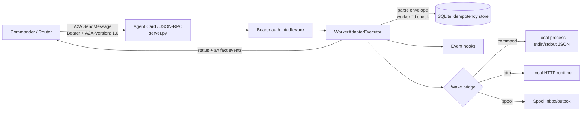
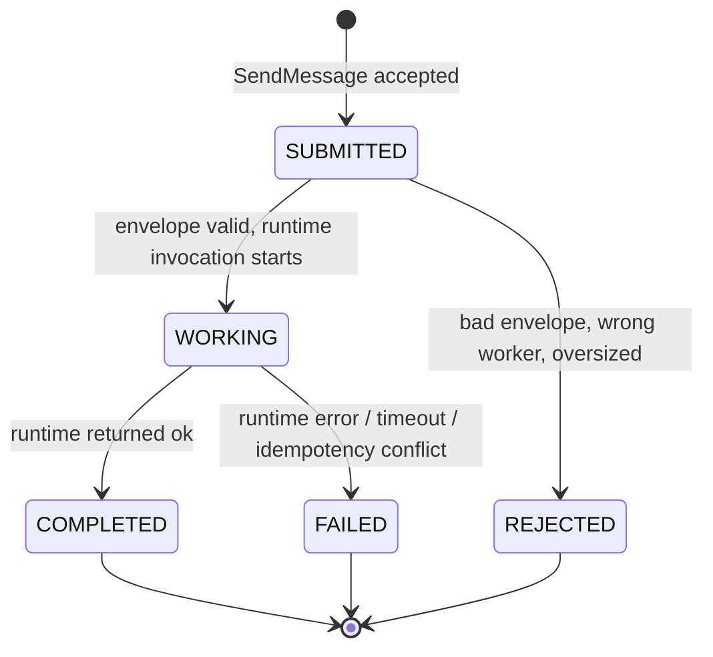

# A2A Worker Adapter

**A deterministic A2A 1.0 worker adapter for heterogeneous multi-agent fleets** — it turns any local agent runtime (a CLI process, an HTTP service, or a file-spool consumer) into an authenticated, idempotent A2A agent that a commander/router can discover and dispatch tasks to.

A successful A2A response means the task was *delivered and the runtime was woken*; business-level completion stays authoritative in the caller's own task ledger. The adapter never pretends a wake is a finished job.

## Features

- **A2A 1.0 JSON-RPC** server built on the official `a2a-sdk`, with a public Agent Card (`/.well-known/agent-card.json`) declaring Bearer auth.
- **Bearer authentication** enforced on every route except the Agent Card and `/healthz`.
- **Persistent idempotency**: results are stored in SQLite keyed by `(worker_id, messageId)`. Replays with the same stable messageId return the cached result — even across restarts, and even when the A2A transport mints a new Task UUID (transport fields are excluded from the payload hash). The same messageId with a *different* business payload is rejected with `IDEMPOTENCY_CONFLICT`.
- **In-flight duplicate suppression**: concurrent duplicates of one messageId execute the runtime exactly once.
- **Three runtime wake bridges**:
  - `command` — run a fixed executable (no shell), task JSON on stdin, result JSON on stdout;
  - `http` — POST to a local runtime endpoint, loopback-only unless explicitly allowed;
  - `spool` — atomic file drop in an inbox directory, result picked up from an outbox (for runtimes that cannot be woken directly).
- **Addressing safety**: tasks addressed to a different `worker_id` are rejected; message size is capped (`A2A_MAX_MESSAGE_BYTES`).
- **Event hooks** (extension points) for logging, metrics, webhooks and audit — see [Hooks](#hooks).
- **No secrets in artifacts**: runtime raw responses and credentials are never dumped into A2A artifacts; only a small allow-listed metadata set is exposed.

## Architecture



Task lifecycle inside the adapter:



## Quick start

```bash
python3 -m venv .venv
.venv/bin/python -m pip install -r requirements.txt

cp .env.example .env   # set A2A_BEARER_TOKEN and your worker identity
set -a; . ./.env; set +a

# Demo wake bridge: a fake local runtime that echoes the task message
WORKER_WAKE_MODE=command \
WORKER_WAKE_COMMAND=".venv/bin/python tests/fake_runtime.py" \
.venv/bin/python server.py --host 127.0.0.1 --port 8000
```

In another terminal, dispatch a task:

```bash
A2A_BEARER_TOKEN=<same-token> .venv/bin/python client.py \
  --url http://127.0.0.1:8000/ \
  --task-id T-1001 --worker-id worker-a \
  --message "status check"
```

For a given `task_id + worker_id + context_version`, `client.py` derives a stable A2A messageId, so re-sending the same payload is retry-safe and will not execute twice.

Run the test suite and the end-to-end smoke test:

```bash
.venv/bin/python -m unittest discover -s tests -v
./smoke_test.sh
```

## Task envelope

The message text of an A2A task is either plain text or a JSON envelope:

```json
{
  "task_id": "T-1001",
  "worker_id": "worker-a",
  "message": "run the nightly report",
  "context_link": "https://example.com/context/T-1001",
  "input_link": "https://example.com/input/T-1001",
  "done_criteria": "report file exists and summary posted",
  "classification": "P1",
  "context_version": "1"
}
```

## Hooks

Hooks are lightweight event callbacks that run alongside the adapter without touching its code. A failing hook is logged and swallowed — it can never break task execution.

| Event | Fires when |
| --- | --- |
| `on_message_received` | a task envelope was received and parsed |
| `on_task_created` | the A2A task object was created |
| `on_task_state_changed` | the task moves to WORKING / COMPLETED / FAILED |
| `on_task_completed` | the task completed (with result metadata) |
| `before_dispatch` | just before the runtime bridge is invoked |
| `after_dispatch` | right after the runtime bridge returns |

Two ways to add hooks:

1. **In code** — import `hooks` and register:

   ```python
   import hooks

   @hooks.register("on_task_completed")
   def audit(task_id, ok, details, **_):
       print(f"task {task_id} finished, ok={ok}")
   ```

2. **As an operator module** — point `HOOKS_MODULE` at a module name or a `.py` file; functions named after the events are registered automatically:

   ```bash
   HOOKS_MODULE=examples/example_hooks.py python server.py ...
   ```

   See [`examples/example_hooks.py`](examples/example_hooks.py) for a ready-made module that logs task events to a JSONL file and can forward completions to a webhook.

## Protocol

The fleet-level protocol this adapter implements — roles, dispatch flow, state mapping between A2A tasks and the caller's task ledger, reliability rules and production acceptance criteria — is documented in [docs/PROTOCOL.md](docs/PROTOCOL.md).

## Configuration

All configuration is via environment variables; see [`.env.example`](.env.example) for the full list. Never commit a real `.env` (it is git-ignored).

## License

MIT — see [LICENSE](LICENSE). Copyright (c) 2026 William Huang (ieyer).
